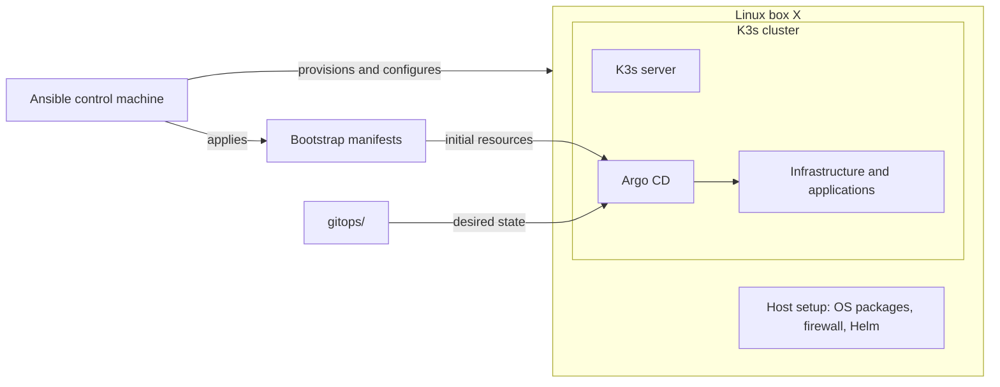

# kubernetes_k3s_cluster

Installation and configuration of K3s, Helm, and Argo CD using Ansible and GitOps.

## Requirements

- x86-64 or ARM/aarch64 hosts.
- Fedora/RHEL-family Linux is tested. Debian/Ubuntu may work but has not been tested.
- Ansible on the control machine (`pip3 install --user ansible`).
- Passwordless SSH and sudo access to the cluster hosts.

## Architecture

## Ansible setup

The [README.md](1-install-k3s-with-ansible/README.md) in the Ansible directory
covers inventory settings and the install, upgrade, and removal commands.

## GitOps

During installation, `argo_bootstrap: true` applies the initial resources in
[2-argo_bootstrap/](2-argo_bootstrap/). Argo CD then syncs the applications and
infrastructure in [gitops/](gitops/) and manages its own configuration. See its
[README.md](gitops/infra/argocd/README.md) for details.
